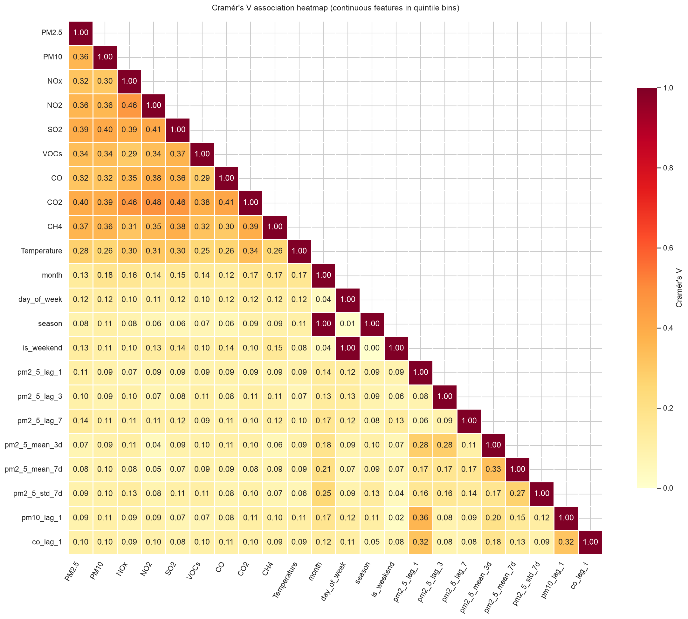

# Air Quality & PM2.5 Risk Analysis

An end-to-end data science workflow that turns 500 days of air-quality measurements into engineered features, statistically validated insights, and an interactive PM2.5 risk dashboard.


---

## Overview

This project explores the drivers and temporal patterns of **PM2.5** pollution and converts them into practical, day-level insights. It covers the full analytical path from raw data cleaning through feature engineering, association analysis, seasonal and month-wise diagnostics, and a composite risk index — all delivered in a self-contained interactive HTML dashboard.

The current scope is **insights and dashboarding**. Predictive modeling is planned as the next phase.

## Key Highlights

- Cleaned and validated a **500 × 10** air-quality dataset.
- Built a **23-column feature set** with calendar signals, lags, and rolling-window statistics.
- Quantified feature redundancy with a **Cramér's V association matrix** across 22 features.
- Produced seasonal and month-wise PM2.5 diagnostics with actionable interpretations.
- Designed a **composite risk index** with data-driven quantile categories.
- Shipped a **single-file dashboard** with filters, KPIs, five charts, and a sortable, paginated table.

## Dataset

The raw file `air_quality_dataset.csv` contains **500 daily observations** and **10 numeric environmental measurements**:

| Column | Description |
|---|---|
| `PM2.5` | Fine particulate matter — the primary analysis target |
| `PM10` | Coarse particulate matter |
| `NOx` | Nitrogen oxides |
| `NO2` | Nitrogen dioxide |
| `SO2` | Sulfur dioxide |
| `VOCs` | Volatile organic compounds |
| `CO` | Carbon monoxide |
| `CO2` | Carbon dioxide |
| `CH4` | Methane |
| `Temperature` | Ambient temperature |

**PM2.5 summary:** mean **54.67**, standard deviation **22.80**, range **10.76 – 127.62**.

> **Temporal assumption:** the raw dataset has no timestamp column. Rows are treated as consecutive daily readings anchored at **2023-01-01**, which enables calendar, lag, and rolling features. The anchor date is configurable in `data-analysis.ipynb`.

## Workflow

### 1. Data cleaning

- Detected physically invalid negative concentrations in `NOx`, `NO2`, and `SO2`.
- Clipped all pollutant values to a minimum of zero before feature construction.

### 2. Temporal feature engineering

Generated a daily `timestamp` index and derived:

| Feature group | Columns |
|---|---|
| Calendar | `timestamp`, `month`, `day_of_week`, `is_weekend`, `season` |
| PM2.5 lags | `pm2_5_lag_1`, `pm2_5_lag_3`, `pm2_5_lag_7` |
| PM2.5 rolling statistics | `pm2_5_mean_3d`, `pm2_5_mean_7d`, `pm2_5_std_7d` |
| Cross-pollutant lags | `pm10_lag_1`, `co_lag_1` |

Rolling windows use **past days only** (shifted by one day), so the current day's PM2.5 does not leak into its own predictors. The processed output is saved to `data/processed/air_quality_features.csv` (**500 × 23**).

### 3. Association analysis with Cramér's V

Continuous features are discretized into quintiles, then pairwise Cramér's V is computed to capture **non-linear and categorical associations** that Pearson correlation can miss.



| Feature pair | Cramér's V | Interpretation |
|---|---:|---|
| `month` ↔ `season` | 1.00 | Deterministic — `season` is derived from `month` |
| `day_of_week` ↔ `is_weekend` | 1.00 | Deterministic — `is_weekend` is derived from weekday |
| `NO2` ↔ `CO2` | 0.48 | Combustion-gas cluster |
| `SO2` ↔ `CO2` | 0.46 | Combustion-gas cluster |
| `NOx` ↔ `NO2` | 0.46 | Combustion-gas cluster |
| `NOx` ↔ `CO2` | 0.46 | Combustion-gas cluster |

This analysis is diagnostic only — **no features were combined or dropped**. Quintile binning keeps the estimates conservative.

## Actionable Insights

### Seasonal patterns

- Seasonal mean PM2.5 is fairly stable (**53.6 – 55.8**), but the tails differ sharply.
- **Winter has the most extreme peaks:** maximum **127.6**, mean **55.8**, median **49.3**, and **23.3%** of days above 75 µg/m³.
- **Autumn is broadly elevated and volatile:** mean **55.7**, widest IQR (**41.3**), and **5.5%** of days above 100 µg/m³.
- Practical takeaway: prioritize **winter-focused interventions** and keep autumn as a secondary high-risk window.

### Month-wise behavior (January, June, September 2023)

- Average PM2.5 declines across the sampled months: **63.29 → 57.75 → 53.97 µg/m³**.
- January is the most extreme month: standard deviation **23.78**, range **89.08**, **11 days above 75** and **2 days above 100 µg/m³**.
- Daily behavior is spiky rather than smooth. Relative volatility rises as the mean falls: **CV 37.6% (Jan) → 39.8% (Jun) → 42.5% (Sep)**.
- Weekday rankings **flip between months** (Saturday is highest in January but lowest in June), so weekday alone is not a stable predictor.

### Composite risk index

A day-level risk score combines the three main pollution drivers after min-max scaling:

```text
risk_score = 0.5 × scaled PM2.5 + 0.3 × scaled PM10 + 0.2 × scaled CO
```

Scaling prevents CO (raw range ~0.4 – 4.8) from being overwhelmed by PM10 (raw range ~13 – 172).

| Category | Threshold | Days | Share |
|---|---|---:|---:|
| Low | ≤ 0.3337 | 250 | 50% |
| Medium | 0.3337 – 0.5798 | 125 | 25% |
| High | 0.5798 – 0.6563 | 75 | 15% |
| Critical | > 0.6563 | 50 | 10% |

**Category profiles (means):**

| Category | PM2.5 | PM10 | CO |
|---|---:|---:|---:|
| Low | 37.4 | 62.4 | 1.70 |
| Medium | 57.4 | 93.1 | 2.22 |
| High | 81.9 | 117.0 | 2.96 |
| Critical | 93.5 | 126.6 | 3.29 |

The quantile split guarantees a manageable triage capacity: the top **10%** of days become *Critical* alerts and the next **15%** become *High* alerts. The score is a **relative index**, not a regulatory AQI, and thresholds should be re-fitted on new data.

## Interactive Dashboard

`Actionable Insights/air_quality_dashboard.html` is a self-contained dashboard with all 500 records embedded.

**Features**

- KPI cards: days in view, average PM2.5, peak PM2.5, critical-day count, average risk score.
- Filters: season, risk level, month, year, date range, and reset.
- Charts:
  - Daily PM2.5 trend with 75 and 100 µg/m³ alert lines.
  - Average PM2.5 by season.
  - Risk-category distribution.
  - Average PM2.5 by weekday.
  - Monthly average PM2.5.
- Sortable, paginated daily-detail table.

Open it directly in a browser:

```bash
open "Actionable Insights/air_quality_dashboard.html"
```

> The page loads Chart.js from a CDN, so an internet connection is required for charts.

## Project Structure

```text
.
├── air_quality_dataset.csv              # Raw 500 × 10 dataset
├── data-analysis.ipynb                  # Cleaning, feature engineering, Cramér's V
├── data/
│   └── processed/
│       └── air_quality_features.csv     # Engineered 500 × 23 dataset
├── Actionable Insights/
│   ├── insights.ipynb                   # Seasonal, month-wise, and risk analysis
│   └── air_quality_dashboard.html       # Self-contained interactive dashboard
├── assets/
│   └── cramers_v_heatmap.png            # Association heatmap
├── src/
│   └── end_to_end_data_science_project/
├── pyproject.toml
├── uv.lock
└── README.md
```

## Getting Started

**Prerequisites:** Python 3.12+ and [uv](https://docs.astral.sh/uv/).

```bash
git clone https://github.com/nnautomator-debug/Data-Science-Project.git
cd Data-Science-Project
uv sync
```

Then open the notebooks in Jupyter Lab, VS Code, or PyCharm using the project's `.venv` kernel:

1. Run `data-analysis.ipynb` to regenerate `data/processed/air_quality_features.csv` and the heatmap.
2. Run `Actionable Insights/insights.ipynb` to reproduce the seasonal, month-wise, and risk analyses.
3. Open `Actionable Insights/air_quality_dashboard.html` in a browser.

## Tech Stack

| Layer | Tools |
|---|---|
| Data manipulation | pandas, NumPy |
| Statistics | SciPy (chi-square, Cramér's V) |
| Visualization | Matplotlib, Seaborn |
| Dashboard | HTML, CSS, JavaScript, Chart.js |
| Environment | Python 3.12, uv |

## Key Takeaways

- Seasonal averages are similar, but **winter drives the most severe PM2.5 spikes**.
- **Autumn is elevated and volatile**, making it a secondary risk window.
- Daily pollution is **spiky**, so spike detection beats relying on monthly averages.
- `month`/`season` and `day_of_week`/`is_weekend` are perfectly redundant pairs and should be represented by one feature each in future models.
- A quantile-based risk index cleanly separates **Critical (10%)** and **High (15%)** days for operational triage.

## Limitations & Assumptions

- The raw data has **no real timestamps**; the daily timeline is an explicit, configurable assumption.
- The dataset is small and shows **weak temporal autocorrelation**, so findings are descriptive rather than causal.
- Cramér's V uses quintile binning, which intentionally discards within-bin variation.
- Risk thresholds are **relative to this dataset** and should be recalibrated before operational use.
- The dashboard embeds a snapshot of the processed data; regenerate the HTML payload if the dataset changes.

## Roadmap

- [ ] Next-day PM2.5 regression using time-series cross-validation.
- [ ] Data-driven risk classification with learned feature weights.
- [ ] Automated data-refresh and dashboard-regeneration pipeline.
- [ ] Model monitoring and threshold recalibration on new data.

## Author

Built by [@nnautomator-debug](https://github.com/nnautomator-debug).
